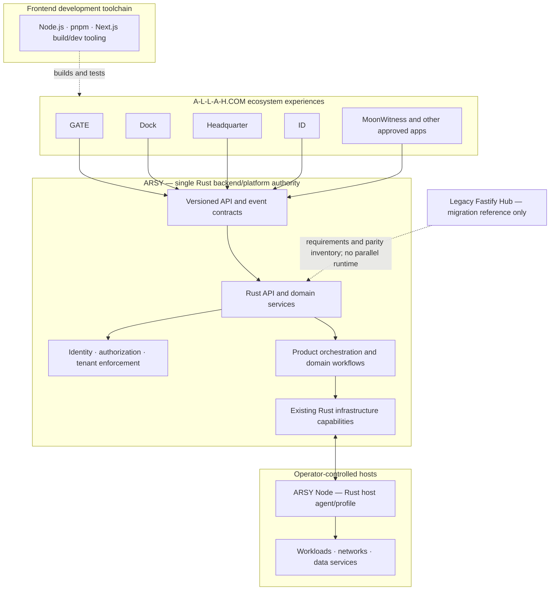

# A-L-L-A-H.COM / Empire of Light — Rust-First Monorepo Blueprint

## 1. Canonical decisions

| Concern | Final decision |
|---|---|
| Organization | BRIDGE-ALLAH |
| Canonical repository | BRIDGE-ALLAH/EMPIRE-OF-LIGHT |
| Public ecosystem brand | A-L-L-A-H.COM |
| Vision | Empire of Light |
| Unified platform | ARSY |
| Repository architecture | One monorepo |
| Backend/platform authority | Rust |
| Web applications | Existing Next.js / React stacks |
| Node.js | Frontend tooling only where needed |
| VPS distribution profile | ARSY Node, Rust-first |

There is one canonical source repository and one backend authority: Rust. The separate bjo163/A-L-L-A-H.COM repository is a migration source, not a second long-term platform repository.

## 2. Product definition

A-L-L-A-H.COM is the public ecosystem identity. Empire of Light is the overarching vision. ARSY is the unified Rust-first platform coordinating ecosystem applications and infrastructure capabilities.

This is a monorepo, not a monolith. Keep bounded Rust crates and independently deployable Rust services where justified. Do not create a service for every module.

## 3. Target logical layout

    BRIDGE-ALLAH/EMPIRE-OF-LIGHT
    |
    +-- existing Cargo workspace / Rust platform
    |   +-- ARSY API and platform services (audit existing crates first)
    |   +-- identity, access and tenant enforcement (single authority)
    |   +-- orchestration and platform domain services
    |   +-- infrastructure/runtime/build/deployment capabilities
    |   +-- ARSY Node / host agent and operations
    |
    +-- apps/
    |   +-- gate/                 Public ecosystem entrance
    |   +-- dock/                 Main user-facing home
    |   +-- headquarter/          Administrative/operational experience
    |   +-- id/                   Identity and access experience
    |   +-- moonwitness/          Knowledge/research/publishing experience
    |   +-- rocksoul/             Creative/media experience
    |   +-- other verified apps
    |
    +-- packages/                 Shared UI, generated SDKs, schemas, tooling
    +-- contracts/                Rust-owned/versioned API and event contracts
    +-- docs/                     Narrative, blueprint, ADRs, app docs, plans
    +-- scripts/ and deployment/  CI, release, verification, install, recovery

This is a target logical view, not an instruction to relocate the current Cargo workspace. Keep its root and crate identities stable unless evidence demonstrates a necessary change. pnpm may remain for frontend packages and build tooling; it must not introduce a competing backend authority.

### Architecture at a glance

The diagram describes the target ownership model. It is not a claim that every application, API, or migration has already been completed.

## 4. Backend authority — Rust

Rust owns:
- ecosystem API and backend service layer;
- authentication integration and authoritative authorization enforcement;
- tenant isolation and access policy enforcement;
- orchestration and platform domain workflows;
- infrastructure build/deployment/runtime execution;
- node lifecycle and host operations;
- platform operational state and telemetry;
- stable public/internal API contracts.

First audit existing crates and services. Reuse and extend what exists. Do not assume a missing capability before checking source, tests, docs, migrations, and feature flags.

Use Rust libraries/crates for internal modularity. Separate processes only where security isolation, independent scaling, lifecycle, or fault containment makes it worthwhile.

## 5. Frontend and tooling boundary

Next.js/React applications remain presentation and product-experience layers. They consume documented Rust APIs and never bypass server-side authorization.

Node.js may be used for:
- Next.js and frontend development/build tooling;
- pnpm workspace management;
- code generation and developer scripts when appropriate.

Node.js is not an ARSY backend runtime in this target architecture. Do not add Fastify, Express, Nest, or another Node backend as a parallel authority.

## 6. Legacy Fastify ARSY Hub disposition

The Fastify service in bjo163/A-L-L-A-H.COM is a migration reference, not a production target.

Required process:
1. Inventory routes, handlers, domain logic, authentication, RBAC, tenant model, persistence, events, jobs, integrations, and tests.
2. Map each capability to existing Rust crates and platform services.
3. Mark each item reuse, extend, port, replace, or retire.
4. Port only required behavior that has no suitable Rust owner.
5. Define and test stable API compatibility for frontend consumers.
6. Cut consumers over to Rust APIs.
7. Retire Fastify only after parity, security, migration, and operational gates pass.

Do not port file-by-file or preserve duplicated business rules. Keep the source repository intact until verified migration and cutover.

## 7. Single source-of-truth rules

| Domain | Authoritative owner |
|---|---|
| Backend APIs and platform policy | ARSY Rust platform |
| Identity/access/tenant enforcement | ARSY Rust platform |
| Build/deploy/runtime execution | Existing Rust infrastructure capabilities |
| Infrastructure node state | Rust platform/node agent |
| Application experience | Owning frontend app |
| Product billing/catalog/entitlements | Ecosystem commercial domain, integrated through Rust APIs |
| Infrastructure usage facts | Rust platform |
| Platform operational telemetry | Rust platform |
| Product analytics and business audit | ARSY / owning product domain |
| MoonWitness knowledge and narrative | MoonWitness |
| ROCKSOUL creative/media | ROCKSOUL |
| Communication signal network | ARSY Radio domain through explicit contracts |

## 8. API and contract design

- Rust owns canonical API and event schemas.
- Version contracts and define compatibility/deprecation policy.
- Authenticate every service-to-service call.
- Never trust browser-supplied tenant or role claims.
- Use stable principal and tenant references with explicit authorization checks.
- Use idempotency keys for mutating operations.
- Return durable operation IDs for asynchronous work.
- Propagate correlation IDs through API, worker, node, logs, and audit.
- Define timeouts, retries, cancellation, reconciliation, and compensation.
- Redact secrets and sensitive payloads from logs.
- Generate or validate frontend SDKs against the canonical contracts.
- Do not share private database tables across application boundaries.

## 9. Current implementation and migration truth

The destination currently contains the substantial Temps-derived Rust/Cargo platform workspace. The source repository bjo163/A-L-L-A-H.COM contains a pnpm workspace, Fastify ARSY Hub, Next.js apps, shared packages, and plans/docs.

The target is Rust-first, but consolidation is not complete. Fastify must be audited as a migration source and its required capabilities reconciled into Rust. Frontend apps/packages and their tooling may retain Node.js where needed. Do not claim the Rust backend already covers every legacy Fastify capability until route/domain parity is verified.

Preserve applicable upstream licenses, NOTICE, copyright, and third-party attribution. The existing scripts/install.sh still targets upstream Temps release assets and is not an ARSY Node installer.

## 10. Monorepo migration sequence

### Phase A — Inventory and Rust capability map
- Inventory both repositories, branches, packages, crates, apps, APIs, schemas, migrations, workflows, secrets, deployment targets, docs, plans, and issues.
- Map every Fastify route/domain capability against the existing Rust workspace.
- Identify duplicate or overlapping Rust capabilities.
- Create a migration ledger with source, target, owner, action, status, verification, and commit.

Exit: every maintained component and backend capability has an explicit disposition.

### Phase B — Establish Rust API authority
- Select the existing Rust crate(s) that should own API and platform entrypoints based on code audit.
- Document identity, authorization, tenant, error, pagination, versioning, and operation contracts.
- Implement missing capability only after confirming no existing owner.
- Add Rust tests and API contract fixtures.

Exit: a clear Rust-owned backend/API entrypoint and tested contracts exist.

### Phase C — Migrate frontend and shared packages
- Bring approved Next.js apps and shared UI packages into the monorepo without disturbing Cargo.
- Keep Node tooling scoped to frontend/build tasks.
- Generate or validate frontend clients from Rust-owned contracts.
- Cut frontend consumers over from Fastify endpoints to Rust endpoints.
- Preserve app blueprints, assets, plans, and tests.

Exit: maintained frontend apps build independently and consume the Rust API.

### Phase D — Reconcile legacy Fastify behavior
- Port missing domain behavior into Rust by bounded capability.
- Validate behavior and security parity.
- Migrate data only with explicit schema mapping, backup, and rollback.
- Remove obsolete Fastify routes/clients only after consumer cutover and tests.
- Record all retained/deferred/retired capabilities.

Exit: no production app depends on Fastify as a backend.

### Phase E — CI, release, and operations
- Preserve and test the existing Rust baseline.
- Add frontend workspace checks without making Node a backend.
- Add API/security/integration contract tests.
- Publish traceable Rust artifacts, SBOM, checksums, signatures/provenance, and release notes.
- Implement ARSY Node preflight, install, health, upgrade, rollback, backup, restore, and uninstall.
- Test clean-host installation and recovery.

Exit: canonical CI, Rust release, frontend builds, and VPS operations are reproducible.

### Phase F — Source cutover
- Verify clean checkout, Rust tests, app builds, API parity, security boundaries, and deployment profiles.
- Reconcile active issues/plans/branches.
- Update the source repository with canonical destination and migration status.
- Archive or make the source read-only only after no active dependency remains.

Exit: all active development uses BRIDGE-ALLAH/EMPIRE-OF-LIGHT.

## 11. ARSY Node requirements

- Version-pinned Rust artifacts built by canonical CI.
- Supported OS/architecture matrix.
- Checksums and verifiable signatures/provenance.
- Least-privilege service accounts and explicit host permissions.
- Safe secret generation and configuration.
- Idempotent install and recovery from interrupted operations.
- Health checks and actionable diagnostics.
- Compatibility manifest for platform components.
- Backup/restore, upgrade/rollback, and uninstall.
- Clean-host test evidence.

Hard stop: do not rename the current upstream Temps installer and do not claim ARSY Node is ready until these gates pass.

## 12. Anti-overlap rules

1. Search the existing Rust workspace before adding a crate or service.
2. Treat Fastify as legacy migration evidence, not a second backend target.
3. Map behavior and contracts before porting; never copy files blindly.
4. One owner per data domain, API, policy, and persistence model.
5. Frontends consume documented APIs and cannot bypass authorization.
6. Node.js is limited to frontend/tooling roles in this architecture.
7. Do not create separate repositories to avoid monorepo integration.
8. Do not split every module into a microservice.
9. Preserve upstream legal attribution and technical compatibility.
10. Keep migration batches small, autonomous, testable, and reversible.

## 13. Definition of done

A clean checkout contains the authoritative Rust backend/platform, approved applications, shared frontend packages, Rust-owned contracts, deployment profiles, and documentation. Rust tests and frontend builds are reproducible; API and access boundaries are tested; every capability has one owner; ARSY Node has clean-host evidence; and no active development or production deployment depends on the source repository or a Fastify backend.

One ecosystem. One canonical monorepo. One Rust-first backend authority.
